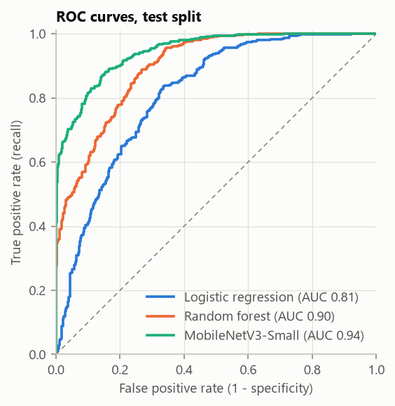
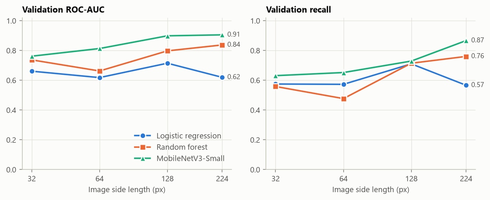
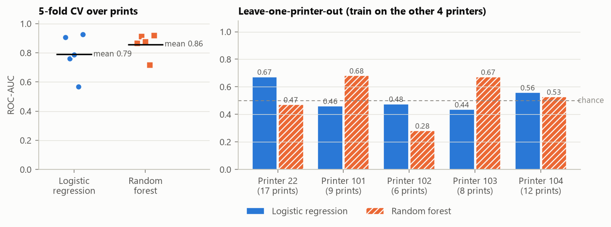
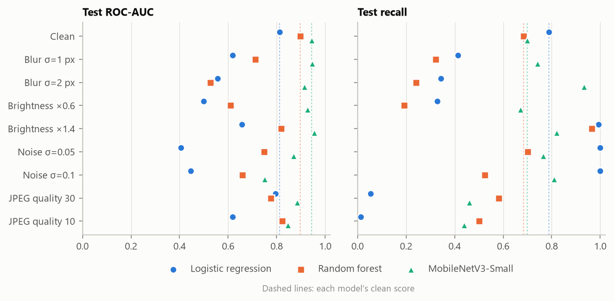
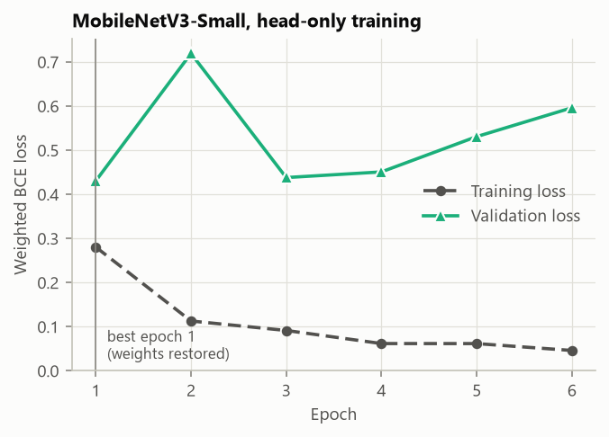

# fdm-defect-detection

Detecting **under-extrusion** in FDM 3D printing from close-up nozzle-camera
images, comparing a hand-crafted-feature baseline (NumPy features + logistic
regression / random forest) with a pretrained CNN (MobileNetV3-Small).

MMA3001 Numerical Methods and Machine Learning, individual project.

- **API documentation:** [docs/index.html](docs/index.html) (pdoc; open locally)
- **Test report:** [results/test_report.html](results/test_report.html)
- **Results table:** [results/comparison.md](results/comparison.md)
- **Data description:** [data/README.md](data/README.md)
- **AI-use log:** [AI_USE.md](AI_USE.md)

---

## 1. Engineering problem

In fused deposition modelling (FDM) a nozzle extrudes a bead of molten plastic
along each tool path. **Under-extrusion** (too little plastic, from a partial
clog, wet filament, a slipping extruder gear or too low a temperature) leaves
thin, gapped beads. Parts come out weak and porous, and a print that keeps
running after the fault starts wastes hours of machine time and material.

The goal is an **early-warning monitor**: a model that looks at each frame from
a camera mounted beside the nozzle and estimates the probability that the
printer is under-extruding, so a failing print can be paused.

Camera-based monitoring of extrusion printers has been shown to work at scale:
Brion and Pattinson [10] trained multi-head neural networks to detect and
correct a range of printing errors in real time across different printers.
This project studies a narrower problem, under-extrusion only, on a small
public dataset [13], with an emphasis on honest validation and computational
cost.

Formally this is **binary image classification** per frame. Requirements that
follow from the use case:

| Requirement | Why | How it is checked |
|---|---|---|
| High **recall** (catch defective frames) | a missed defect wastes the print | recall is the primary metric |
| Acceptable **specificity** (few false alarms) | needless pauses cost time and trust | reported with every result |
| **Generalise to unseen prints** (and ideally printers) | the monitor must work on new jobs | print-level split, grouped CV, leave-one-printer-out |
| **Real-time on a CPU** | frames arrive every ~0.41 s; no GPU on a printer | per-image latency, FLOPs, memory |
| **Robust to camera conditions** | focus, lighting and compression vary | corrupted-image tests without retraining |

## 2. Inputs and outputs

### Inputs

| Input | Format | Units / domain | Notes |
|---|---|---|---|
| Image | JPEG or PNG file, 8-bit, RGB (greyscale/RGBA converted to RGB) | any size (dataset frames are 1280 × 720 px) | resized (bilinear) to `size × size`, default **128 px**; aspect ratio is not preserved |
| Image array (in memory) | `numpy.ndarray`, shape `(H, W, 3)`, `float32/float64` | values in **[0, 1]**, H, W ≥ 3 | as returned by `fdm_defect.data.load_image` |
| Metadata CSV | UTF-8 CSV, one row per image | see below | `data/train_subset.csv` |
| `img_path` | string | `<printer_id>/<print_id>/<unix_timestamp>.jpg`, relative to the image folder | `\` accepted and normalised to `/` |
| `printer_id` | integer | printer id (22, 101, 102, 103, 104) | must match the first folder in `img_path` |
| `print_id` | integer | unix start time of the print (s) | must match the second folder in `img_path` |
| `has_under_extrusion` | integer | {0, 1}; 1 = under-extrusion | must be constant within a print |
| `size` | `int` | pixels, > 0 | image side length |
| `val_frac`, `test_frac` | `float` | each in (0, 1), sum < 1 | fraction of prints per class sent to val/test |
| `seed` | `int` | any | default 42; fixes splits, models and augmentation |

### Outputs

| Output | Type | Domain | Notes |
|---|---|---|---|
| Probability of under-extrusion | `numpy.ndarray` of `float` | [0, 1] | `baseline.predict_proba`, `cnn.predict_proba`, `cnn.predict_proba_images` |
| Binary label | `int` | {0, 1} | `1` if probability ≥ threshold (default **0.5**) |
| Print-level probability | `float` | [0, 1] | mean frame probability over a print (`evaluate.group_level`) |
| Feature vector (baseline) | `numpy.ndarray` `float64`, length 43 | unbounded reals | names from `features.feature_names()` |
| Metrics | `dict` / CSV | recall, precision, F1, specificity, accuracy, ROC-AUC in [0, 1] | `evaluate.binary_metrics`, `evaluate.bootstrap_ci` |

### Invalid-input handling

Every public function validates its inputs and fails loudly with a specific
exception and message instead of returning a wrong answer. All cases below are
covered by tests.

| Invalid input | Raised by | Exception |
|---|---|---|
| CSV, image folder or an image file missing | `load_metadata`, `load_image` | `FileNotFoundError` (reports how many images are missing, with examples) |
| Required column missing, table empty, null values | `validate_metadata` | `ValueError` |
| Id or label column not integer (e.g. `"yes"/"no"`) | `validate_metadata` | `TypeError` |
| Label not 0 or 1 | `validate_metadata`, `fit_baseline`, `binary_metrics` | `ValueError` |
| `img_path` malformed or disagreeing with `printer_id`/`print_id` | `validate_metadata` | `ValueError` |
| Duplicate `img_path`; a print with two labels or two printers | `validate_metadata` | `ValueError` |
| File is not a readable image | `load_image` | `ValueError` |
| `size` not an integer (including `bool`) / not positive | `load_image` | `TypeError` / `ValueError` |
| Image array not float (e.g. `uint8`), wrong shape, < 3 × 3, NaN/inf, outside [0, 1] | `extract_features`, `corrupt` | `TypeError` / `ValueError` |
| Split fractions out of range; < 3 prints of a class; no training prints left | `split_by_print` | `ValueError` |
| `frames_per_print` not a positive integer; missing `img_path` / `print_id` | `make_subset` | `ValueError` |
| A print in two splits | `check_no_print_leakage` | `ValueError` |
| Training labels with one class; feature matrix with NaN or wrong shape | `fit_baseline`, `train_model` | `ValueError` |
| Hyperparameters out of range (epochs, batch size, lr, patience) | `train_model` | `ValueError` |
| Unknown model / architecture / corruption name | `make_model`, `build_model`, `corrupt` | `ValueError` |

## 3. Setup

Requires Python 3.10+ (developed and tested on Python 3.12, Windows 11, CPU only).

```bash
git clone https://github.com/sweatdungeon/fdm-defect-detection.git
cd fdm-defect-detection
python -m venv .venv
.venv\Scripts\activate              # Windows; on macOS/Linux: source .venv/bin/activate
pip install -r requirements.txt     # exact versions, installs the package in editable mode
```

The images are not in the repository (~750 MB for the subset). Download the
Kaggle data and extract the 6,227-image subset as described in
[data/README.md](data/README.md):

```bash
python scripts/extract_subset.py --zip path/to/images.zip \
    --subset data/train_subset.csv --out data/raw
```

The tests do **not** need the real data: they use a synthetic bead-stripe
generator. The one real-data test is skipped if `data/raw/images/` is absent.

## 4. Workflow

```
Kaggle train.csv ──► scripts/make_subset.py ──► data/train_subset.csv ─┐
Kaggle images.zip ──────────────────────────────────────────────────────┴─► scripts/extract_subset.py ─► data/raw/images/
                                                                                                        │
                         scripts/run_pipeline.py ◄──────────────────────────────────────────────────────┘
   splits → features → baseline → cnn → cv → lopo → sweep → robustness → profiling → report
                                                            │
                                     results/*.csv, results/figures/*.png, results/comparison.md
```

```bash
python scripts/make_subset.py --train train.csv --check  # verify the subset (optional)
python scripts/run_pipeline.py                         # everything, ~12 min on a desktop CPU (i5-14600KF)
python scripts/run_pipeline.py --stages sweep report   # a subset of stages
python scripts/make_report.py                          # rebuild table and figures from CSVs
python scripts/run_baseline.py                         # baseline only, validation metrics
python scripts/train_cnn.py --size 128                 # CNN only (--full-finetune, --arch resnet18)

pytest                                                 # 205 tests
pytest --html=results/test_report.html --self-contained-html
python scripts/build_docs.py                           # API documentation (pdoc) into docs/
```

Using the package directly:

```python
from fdm_defect import config
from fdm_defect.data import load_metadata, split_by_print
from fdm_defect.cnn import build_model, train_model, predict_proba

df = load_metadata(config.SUBSET_CSV, config.IMAGE_DIR)  # validated metadata
train, val, test = split_by_print(df)                   # whole prints per split
model = build_model("mobilenet_v3_small", pretrained=True)
train_model(model, train, val, epochs=10)
p = predict_proba(model, val)                           # P(under-extrusion) per image
```

### Repository layout

```
src/fdm_defect/
  config.py       paths, default image size (128) and seed (42)
  data.py         load + validate metadata and images; print-level stratified split
  synthetic.py    synthetic bead-stripe images for tests
  features.py     43 hand-crafted NumPy features (histogram, colour, Sobel, LBP, GLCM, FFT)
  baseline.py     logistic regression and random forest on the features
  cnn.py          pretrained MobileNetV3-Small / ResNet-18, training loop, prediction
  evaluate.py     metrics, print-level bootstrap CIs, grouped CV, leave-one-group-out
  robustness.py   blur, brightness, noise and JPEG corruptions
  profiling.py    timing, cProfile, FLOP counter, arithmetic intensity
scripts/          make_subset, extract_subset, run_pipeline, make_report, run_baseline, train_cnn, build_docs
tests/            pytest suite (205 tests)
results/          CSVs, figures, comparison table, test report
docs/             pdoc HTML documentation
data/             subset CSV and data README (images git-ignored)
```

## 5. Methods

### Data and split

The Kaggle competition *Early detection of 3D printing issues* [13] provides 81,060
labelled frames from **52 prints on 5 printers**. Every frame of a print has the
same label, and consecutive frames (~0.41 s apart) are near-duplicates, so the
**independent sample size is 52 prints, not 81k images**. A subset of up to 120
evenly spaced frames per print (6,227 images, all 52 prints, 48% defective) is
used; `scripts/make_subset.py` rebuilds it from `train.csv` byte-for-byte (see
[data/README.md](data/README.md)).

The split assigns **whole prints** to train / validation / test (36 / 8 / 8
prints), shuffling good and defective prints separately so each split has both
classes (`data.split_by_print`). An image-level split would put near-identical
frames of the same print on both sides and inflate every metric.
`check_no_print_leakage` asserts no print is in two splits.

### Baseline: hand-crafted features

All features are implemented in NumPy (`features.py`) on the image resized to
128 px and converted to grey with BT.601 weights where needed:

| Group | Count | Definition | Captures |
|---|---|---|---|
| Grey histogram | 16 | normalised counts over [0, 1] | brightness distribution |
| RGB mean / std | 6 | per channel | filament and bed colour |
| Sobel gradients [8] | 5 | mean / std magnitude, mean \|gx\|, mean \|gy\|, edge density (magnitude > 1.0) | bead edges and their direction |
| Uniform LBP [3] | 10 | 8 neighbours, radius 1; labels 0–8 + non-uniform | micro-texture |
| GLCM [4] | 4 | contrast, homogeneity, energy, correlation; 8 levels, offsets right and down, symmetric | grey-level co-occurrence texture |
| 2-D FFT [7] | 2 | share of non-DC power in the peak bin, peak radial frequency | regularity of the bead stripes |

Two classifiers from scikit-learn [11] use them, both with
`class_weight="balanced"`: standardised **logistic regression** (L2), and a
**random forest** [5] (300 trees, `min_samples_leaf=5` to stop trees
memorising individual near-duplicate frames).

### Main model: pretrained CNN

ImageNet-pretrained **MobileNetV3-Small** [1] (`cnn.py`, PyTorch [12]), with
the final 1000-way layer replaced by a single logit; `sigmoid(logit)` is the
probability. ResNet-18 [2] is available as an alternative backbone
(`--arch resnet18`) but was not used for the reported results.

- **Head-only training** (default): the convolutional backbone is frozen and
  only the classifier head is trained (0.59 M of 1.52 M parameters).
- **Frozen BatchNorm kept in eval mode** (`set_train_mode`): otherwise
  `model.train()` would make frozen BatchNorm layers normalise with batch
  statistics and overwrite their ImageNet running statistics.
- **Pretrained weights are required**: MobileNetV3's BatchNorm momentum is
  0.01, so from random weights the running statistics lag the activations and
  the eval-mode network collapses to constant outputs.
- **Loss:** `BCEWithLogitsLoss` with `pos_weight = n_good / n_defective`;
  **optimiser:** AdamW [9] (lr 1e-3, weight decay 1e-4), batch 64.
- **Augmentation:** random horizontal flip, brightness × U(0.8, 1.2).
- **Early stopping** on validation loss (patience 5, max 10 epochs), restoring
  the best weights.

### Evaluation protocol

- **Settings are chosen on validation only.** The test split is scored once
  per final model (both baselines and the CNN at 128 px), and by the
  robustness test with the same fixed models.
- **Metrics** (frame level, threshold 0.5): recall (primary), precision, F1,
  specificity, accuracy, ROC-AUC; plus print-level accuracy from the mean
  frame probability per print.
- **95% confidence intervals:** percentile bootstrap [6] (2,000 resamples) that
  resamples **whole prints**, skipping resamples with only one class.
- **Grouped 5-fold CV** (`StratifiedGroupKFold` over prints) and
  **leave-one-printer-out** for the baselines, on all 52 prints. They measure
  variability between prints and generalisation to a new printer; they are
  reported, never used to choose settings.
- **Resolution sweep:** 32 / 64 / 128 / 224 px for all three models, on validation.
- **Robustness:** test images corrupted at the model input resolution (Gaussian
  blur σ = 1, 2 px; brightness × 0.6, × 1.4; Gaussian noise σ = 0.05, 0.1;
  JPEG quality 30, 10), scored **without retraining**.
- **Profiling:** median `perf_counter` wall-clock time, cProfile of feature
  extraction, `tracemalloc` peak memory, and FLOPs counted with forward hooks
  on every `Conv2d` and `Linear` layer (1 MAC = 2 FLOPs). Arithmetic intensity
  = FLOPs / bytes, with each layer reading its weights and input and writing
  its output once in float32.

## 6. Validation

The code is checked by **205 pytest tests** (all passing; see the
[HTML test report](results/test_report.html)):

| Test file | Tests | What is verified |
|---|---|---|
| `test_data.py` | 53 | every metadata validation error; image loading; split has no print overlap, uses every row once, keeps whole prints, is stratified, deterministic; subset selection at hand-computed positions (including half-to-even rounding); real-data checks (6,227 images, 52 prints; `train.csv` rebuilds the committed subset exactly) |
| `test_features.py` | 41 | **known answers**: Sobel on a ramp g = s·x gives gx = 8s; a pure cosine puts exactly 0.5 of non-DC power in its peak FFT bin at frequency k/N; a two-level checkerboard gives GLCM contrast (L−1)², homogeneity 1/(1+(L−1)²), energy √0.5, correlation −1; hand-worked LBP patterns; step-edge density 2/6; histogram endpoints |
| `test_synthetic.py` | 17 | generator shapes, determinism; a good image's FFT peak is at n_beads; defect images cover less area |
| `test_baseline.py` | 13 | both models separate synthetic classes (≥ 90%); reproducibility; balanced weights; input validation |
| `test_cnn.py` | 35 | frozen backbone; frozen BatchNorm statistics unchanged after a training-mode pass; early stopping (lr = 0 ⇒ stops after 1 + patience epochs); best weights restored; bit-identical weights for equal seeds; pretrained head learns the synthetic task (≥ 80%) |
| `test_evaluate.py` | 19 | metrics vs a hand-counted confusion matrix and ROC-AUC (6/9 pairs); bootstrap CI contains the estimate, is deterministic, skips one-class resamples at the expected rate; CV folds never share a print |
| `test_robustness.py` | 18 | separable blur equals the dense 2-D convolution; kernel sums to 1; noise has the requested std; lower JPEG quality gives larger error |
| `test_profiling.py` | 9 | **FLOP counter vs hand counts** (standard conv 21,600 MACs, depthwise 7,200, linear 4,000); linear arithmetic intensity 8,000 / 19,220; MobileNetV3-Small at 224 px within the published ≈ 0.06 GMACs |

Checks on the real data: the split assertion runs on every pipeline run; the
CNN retrained at 128 px inside the sweep reproduced the main run's validation
ROC-AUC (0.899) exactly; every figure was rendered and inspected.

## 7. Results

All numbers below come from `results/` (one run, seed 42, Windows desktop with an Intel Core i5-14600KF CPU, 14 PyTorch
threads). The machine also has an NVIDIA RTX 3080 GPU, but it was **not used**:
the CPU-only build of PyTorch was installed, so all training, inference and
timing ran on the CPU. This matches the intended deployment, a monitor beside the
printer that is unlikely to have a GPU.

### Test split: 8 prints (4 defective), 960 images

| Model | Recall [95% CI] | Precision [95% CI] | F1 [95% CI] | Specificity [95% CI] | ROC-AUC [95% CI] | Prints correct |
|---|---|---|---|---|---|---|
| Logistic regression | 0.79 [0.59, 0.93] | 0.72 [0.30, 0.97] | 0.75 [0.42, 0.89] | 0.69 [0.48, 0.94] | 0.81 [0.64, 0.96] | 7/8 |
| Random forest | 0.68 [0.29, 0.96] | 0.83 [0.41, 0.99] | 0.75 [0.40, 0.91] | 0.86 [0.73, 0.99] | 0.90 [0.73, 0.99] | 7/8 |
| **MobileNetV3-Small** | 0.70 [0.41, 0.91] | **0.95** [0.75, 1.00] | **0.80** [0.57, 0.92] | **0.96** [0.92, 1.00] | **0.94** [0.86, 0.99] | 7/8 |

### Generalisation (baselines, all 52 prints, 128 px features)

| Model | 5-fold grouped CV ROC-AUC (mean ± sd) | CV recall (mean ± sd) | Leave-one-printer-out ROC-AUC (mean; per printer 22 / 101 / 102 / 103 / 104) |
|---|---|---|---|
| Logistic regression | 0.79 ± 0.14 | 0.72 ± 0.15 | 0.52; 0.67 / 0.46 / 0.48 / 0.44 / 0.56 |
| Random forest | 0.86 ± 0.08 | 0.81 ± 0.06 | 0.53; 0.47 / 0.68 / 0.28 / 0.67 / 0.53 |

### Cost (128 px, CPU)

| Model | Parameters | GFLOP / image | Inference ms / image (batch 1) | Batched ms / image | Model size | Training time |
|---|---|---|---|---|---|---|
| Logistic regression | 44 coefficients | not counted | 1.6 (1.42 features + 0.15) | < 0.01 + features | 2.5 KB | 0.03 s |
| Random forest | 91,282 tree nodes | not counted | 26.5 (1.42 features + 25.1) | 0.04 + features | 7.4 MB | 0.36 s |
| MobileNetV3-Small | 1.52 M (0.59 M trained) | 0.038 | 2.8 | 0.28 | 6.1 MB | 51.8 s (6 epochs) |

JPEG decoding and resizing (5.2 ms per 1280 × 720 frame) is excluded for every
model. The random forest's batch-1 time is dominated by thread start-up
(`n_jobs=-1`), not arithmetic. The CNN's arithmetic intensity is ≈ 3.8 FLOP/byte
at 128 px (6.2 at 224 px), below this CPU's estimated machine balance of
≈ 20 FLOP/byte, so a roofline model places it in the memory-bound region. At
batch 1, however, the ≈ 9.9 MB working set fits in the 24 MB L3 cache, so the
low achieved throughput (13 GFLOP/s) is mainly per-layer overhead from many
small layers; batching amortises that overhead and raises throughput to
135 GFLOP/s, still far below the CPU's peak compute. Feature extraction
peaks at 1.3 MB of NumPy memory per image; cProfile shows the time split
roughly evenly between colour statistics (25%), LBP (19%), Sobel (17%) and FFT (16%).

### Resolution sweep (validation ROC-AUC)

| Size (px) | Logistic regression | Random forest | MobileNetV3-Small | CNN GFLOP / image |
|---|---|---|---|---|
| 32 | 0.66 | 0.74 | 0.76 | 0.004 |
| 64 | 0.62 | 0.66 | 0.81 | 0.011 |
| **128** | 0.72 | 0.80 | 0.90 | 0.038 |
| 224 | 0.62 | 0.84 | 0.91 | 0.111 |

### Robustness (test ROC-AUC, no retraining)

| Condition | Logistic regression | Random forest | MobileNetV3-Small |
|---|---|---|---|
| Clean | 0.81 | 0.90 | 0.94 |
| Blur σ = 1 px / 2 px | 0.62 / 0.56 | 0.71 / 0.53 | 0.95 / 0.91 |
| Brightness × 0.6 / × 1.4 | 0.50 / 0.66 | 0.61 / 0.82 | 0.93 / 0.95 |
| Noise σ = 0.05 / 0.1 | 0.41 / 0.45 | 0.75 / 0.66 | 0.87 / 0.75 |
| JPEG quality 30 / 10 | 0.79 / 0.62 | 0.78 / 0.82 | 0.89 / 0.85 |

### Figures

| | |
|---|---|
|  |  |
|  |  |
|  | |

### Interpretation

- On unseen prints from known printers the CNN ranks frames best (ROC-AUC 0.94)
  and raises the fewest false alarms (specificity 0.96), at 2.8 ms per frame,
  far inside the 410 ms frame interval. Its recall (0.70) is not higher than
  the baselines', so at the default 0.5 threshold it trades some missed frames
  for far fewer false alarms; a lower threshold would raise recall.
- With 8 test prints the confidence intervals overlap heavily; the ranking
  CNN > random forest > logistic regression on ROC-AUC is consistent across
  validation, test and the resolution sweep, but individual differences are
  not established at 95%.
- **The baselines do not transfer to an unseen printer** (leave-one-printer-out
  ROC-AUC ≈ 0.5, chance level), although grouped CV, where other prints from
  the same printer are in training, gives 0.79–0.86. The features mostly
  encode printer-specific appearance (lighting, filament colour, framing).
- The CNN is far more robust to blur, lighting and JPEG artefacts; the
  hand-crafted features collapse toward chance under the same corruptions.
- 128 px captures nearly all of the CNN's accuracy at a third of the 224 px cost.

## 8. Limitations

- **Small number of independent samples.** There are only 52 prints; the test
  split has 8. Confidence intervals are wide and one unusual print moves
  every metric. Frame-level metrics count correlated frames as if independent;
  the print-level bootstrap accounts for this in the intervals but not in the
  point estimates.
- **Cross-printer generalisation is unproven.** The baselines are at chance on
  an unseen printer, and leave-one-printer-out was not run for the CNN, so
  whether the CNN generalises to new printers is unknown. A deployed monitor
  would likely need calibration data from each new printer.
- **Per-print labels.** Every frame of a defective print is labelled
  defective, including frames that may look normal (for example before the
  fault develops). This label noise caps achievable frame-level accuracy.
- **Early stopping on 8 validation prints.** The CNN's validation loss was
  lowest after epoch 1 and the run stopped after 6 epochs; the choice of epoch
  is noisy, and the head overfits the training prints quickly.
- **Threshold not tuned.** All metrics use 0.5; a threshold chosen on
  validation for a target recall was not explored.
- **Preprocessing.** 1280 × 720 frames are squashed to a square, distorting
  bead geometry; the crop around the nozzle was not optimised.
- **CV and leave-one-printer-out include the test prints.** They are reported
  only, never used for model selection, but they are not independent of the
  test-split numbers.
- **Profiling scope.** FLOPs count only convolution and linear layers (no
  BatchNorm, activations, pooling); the baseline's FLOPs were not counted.
  Timings are from one desktop CPU (Intel Core i5-14600KF) and vary between runs
  and machines. GPU timings were not measured (the installed PyTorch build was
  CPU-only, so the machine's RTX 3080 was unused).
- **Subset.** Only up to 120 of each print's 107–4,310 frames are used; the
  held-out Kaggle test set has no labels and was not used.

## 9. AI use

AI assistance (Claude Code) was used throughout and every material
contribution, including the errors it made and how they were found, is logged
in [AI_USE.md](AI_USE.md).

## 10. References

1. A. Howard et al., “Searching for MobileNetV3,” Proc. IEEE/CVF ICCV, 2019, pp. 1314–1324.
2. K. He, X. Zhang, S. Ren and J. Sun, “Deep residual learning for image recognition,” Proc. IEEE CVPR, 2016, pp. 770–778.
3. T. Ojala, M. Pietikäinen and T. Mäenpää, “Multiresolution gray-scale and rotation invariant texture classification with local binary patterns,” IEEE Trans. Pattern Anal. Mach. Intell., vol. 24, no. 7, pp. 971–987, 2002.
4. R. M. Haralick, K. Shanmugam and I. Dinstein, “Textural features for image classification,” IEEE Trans. Syst., Man, Cybern., vol. SMC-3, no. 6, pp. 610–621, 1973.
5. L. Breiman, “Random forests,” Machine Learning, vol. 45, no. 1, pp. 5–32, 2001.
6. B. Efron, “Bootstrap methods: another look at the jackknife,” Ann. Statist., vol. 7, no. 1, pp. 1–26, 1979.
7. J. W. Cooley and J. W. Tukey, “An algorithm for the machine calculation of complex Fourier series,” Math. Comp., vol. 19, no. 90, pp. 297–301, 1965.
8. R. C. Gonzalez and R. E. Woods, Digital Image Processing, 4th ed. Pearson, 2018.
9. I. Loshchilov and F. Hutter, “Decoupled weight decay regularization,” Proc. ICLR, 2019.
10. D. A. J. Brion and S. W. Pattinson, “Generalisable 3D printing error detection and correction via multi-head neural networks,” Nature Communications, vol. 13, 4654, 2022.
11. F. Pedregosa et al., “Scikit-learn: Machine learning in Python,” J. Mach. Learn. Res., vol. 12, pp. 2825–2830, 2011.
12. A. Paszke et al., “PyTorch: An imperative style, high-performance deep learning library,” Proc. NeurIPS, 2019.
13. Kaggle, “Early detection of 3D printing issues” competition, https://www.kaggle.com/competitions/early-detection-of-3d-printing-issues, accessed 24 Oct 2026.

## Licence

Code: MIT, see [LICENSE](LICENSE). The dataset is not redistributed here and is
subject to the Kaggle competition's terms (see [data/README.md](data/README.md)).
